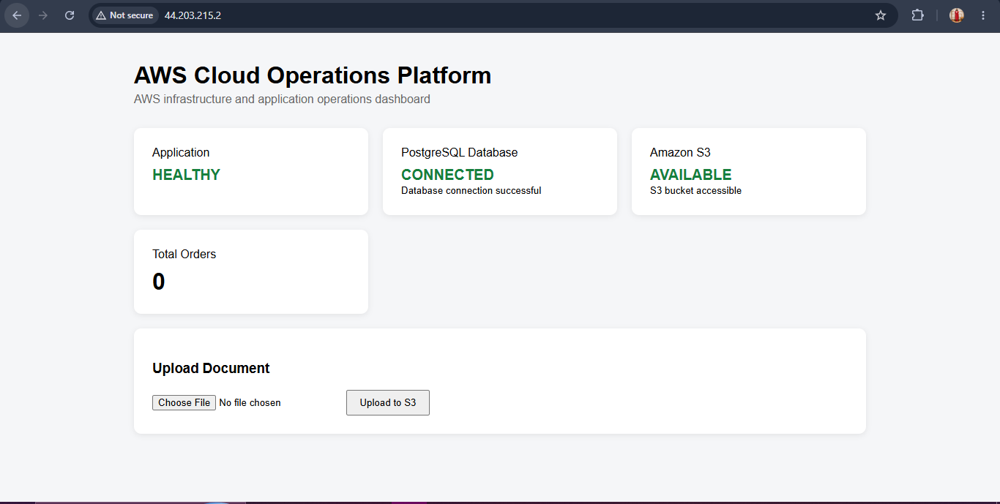
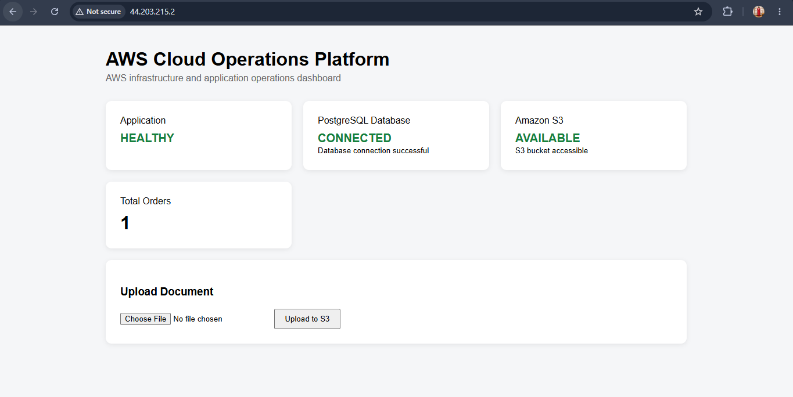
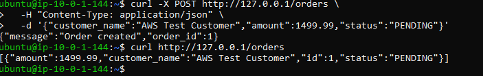
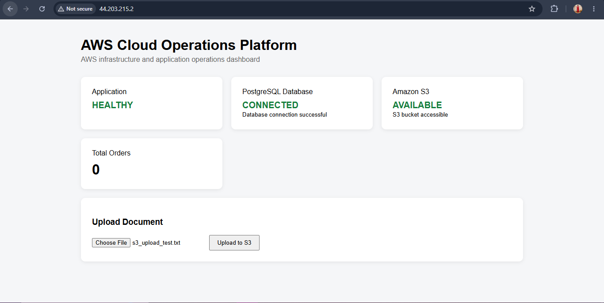
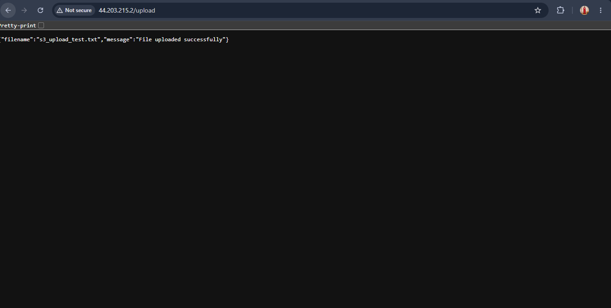
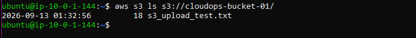

# EC2 Application Setup

After creating the EC2 instance, I prepared it to run the Flask application. The AWS infrastructure itself was already configured at this stage, so this document only covers the server-side application setup performed on EC2.

## 1. Connect to the EC2 Instance

I connected to the Ubuntu EC2 instance using the existing SSH key pair.

Once connected, the shell prompt confirmed that I was working on the EC2 host rather than my local Windows machine.

## 2. Update the Server

I updated the Ubuntu package lists and applied the available package upgrades:

```bash
sudo apt update && sudo apt upgrade -y
```

The upgrade completed successfully. Ubuntu reported that some service restarts were deferred, including a pending kernel update. This did not prevent the application deployment, so I continued without rebooting the instance at this stage.

## 3. Verify the Runtime Environment

Before deploying the application, I checked the versions of the main tools available on the server.

The EC2 environment used:

- Ubuntu 24.04 LTS
- Python 3.12.3
- Git 2.43.0

The application therefore runs with Python 3.12 on the AWS host.

## 4. Install and Configure AWS CLI

The AWS CLI was not available through the default Ubuntu package repository on the instance, so I installed AWS CLI v2 using the official AWS CLI installation package.

After installation, I verified it with:

```bash
aws --version
```

The installed version reported:

```text
aws-cli/2.36.44 Python/3.14.6 Linux/6.17.0-1017-aws exe/x86_64.ubuntu.24
```

I did not configure an access key on the EC2 server.

The instance already had the `cloudops-ec2-s3-role` IAM role attached, so AWS CLI and the application could obtain temporary credentials through the EC2 role.

I also confirmed that the role was intentionally limited to the project's S3 access. For example, an attempt to use the CLI to call RDS APIs resulted in `AccessDenied`, which was expected because the role was not given RDS permissions.

## 5. Copy the Application to EC2

I copied the application directory from my local Windows development environment to the EC2 instance using `scp`.

The application was placed at:

```text
/home/ubuntu/app
```

The deployment copy contained the application source and its dependency definition.

The local `.env` file was not used for the AWS deployment. It was removed from the EC2 copy and the AWS-specific environment values were configured separately on the server.

## 6. Create the Python Virtual Environment

The first attempt to create the virtual environment showed that the Ubuntu venv package was not installed.

I installed the required package:

```bash
sudo apt install python3.12-venv -y
```

I then created the virtual environment inside the application directory:

```bash
cd ~/app
python3 -m venv .venv
source .venv/bin/activate
```

I verified that Python was coming from the virtual environment before installing the application dependencies.

## 7. Install Application Dependencies

The application dependencies were defined in `requirements.txt`:

```text
Flask
boto3
psycopg2-binary
python-dotenv
gunicorn
```

I installed them with:

```bash
pip install -r requirements.txt
```

This installed Flask, boto3, the PostgreSQL driver, python-dotenv, and Gunicorn into the application's virtual environment.

## 8. Configure the AWS Environment

The AWS deployment required environment-specific configuration because the application was no longer connecting to the local PostgreSQL database.

I created the `.env` file manually on EC2 rather than transferring the local file:

```dotenv
APP_NAME=AWS Cloud Operations Platform
DB_HOST=<RDS endpoint>
DB_PORT=5432
DB_NAME=cloudops
DB_USER=cloudopsadmin
DB_PASSWORD=<private RDS password>
S3_BUCKET=cloudops-bucket-01
AWS_REGION=us-east-1
```

The actual database password is intentionally not documented.

I also restricted the file permissions:

```bash
chmod 600 .env
```

This keeps the environment file readable only by the file owner.

## 9. Verify EC2-to-RDS Connectivity

Before starting the application, I verified that the EC2 host could reach the private RDS endpoint on PostgreSQL port `5432`:

```bash
nc -zv <RDS endpoint> 5432
```

The connection succeeded.

I then tested the application's own database connection function:

```bash
python -c "from db import get_connection; conn=get_connection(); print('RDS connection successful'); conn.close()"
```

The application successfully established a PostgreSQL connection to RDS.

At this point, the application was able to communicate with the private database without making RDS publicly accessible.

## 10. Create the Application Table

The RDS database initially did not contain the application's orders table, so I created it from the EC2 application environment using the application's database connection.

The table structure is:

```sql
CREATE TABLE orders (
    id SERIAL PRIMARY KEY,
    customer_name VARCHAR(100) NOT NULL,
    amount NUMERIC(10,2) NOT NULL,
    status VARCHAR(30) NOT NULL DEFAULT 'PENDING',
    created_at TIMESTAMP DEFAULT CURRENT_TIMESTAMP
);
```

I then verified the database through the application environment before proceeding with the web deployment.

## 11. Test Gunicorn Manually

Before creating a persistent service, I wanted to confirm that the application itself could start successfully.

From the application directory, I ran:

```bash
gunicorn --bind 127.0.0.1:8000 app:app
```

Gunicorn started successfully and listened on the local loopback interface.

From a second SSH session, I tested the health endpoint:

```bash
curl http://127.0.0.1:8000/health
```

The application returned:

```json
{"application":"healthy","service":"AWS Cloud Operations Platform"}
```

This confirmed that the Flask application was running correctly under Gunicorn.

## 12. Configure Nginx

Once Gunicorn was working, I installed Nginx:

```bash
sudo apt install nginx -y
```

I configured Nginx to listen on port `80` and proxy requests to Gunicorn on `127.0.0.1:8000`.

The important part of the configuration was:

```nginx
server {
    listen 80;
    server_name _;

    location / {
        proxy_pass http://127.0.0.1:8000;
        proxy_set_header Host $host;
        proxy_set_header X-Real-IP $remote_addr;
        proxy_set_header X-Forwarded-For $proxy_add_x_forwarded_for;
        proxy_set_header X-Forwarded-Proto $scheme;
    }
}
```

I validated the configuration:

```bash
sudo nginx -t
```

The configuration test succeeded, and Nginx was restarted.

I then opened the EC2 public address in a browser and confirmed that the application dashboard was accessible.

### Evidence: Application Running on EC2


## 13. Create a systemd Service

The manual Gunicorn process was useful for initial validation, but it was not a suitable final deployment method because it would depend on an active terminal session.

I created:

```text
/etc/systemd/system/cloudops.service
```

with Gunicorn configured to run the application as a service.

The service uses the application's virtual environment and runs two Gunicorn workers:

```ini
[Unit]
Description=AWS Cloud Operations Platform
After=network.target

[Service]
User=ubuntu
Group=www-data
WorkingDirectory=/home/ubuntu/app
Environment="PATH=/home/ubuntu/app/.venv/bin"
ExecStart=/home/ubuntu/app/.venv/bin/gunicorn --workers 2 --bind 127.0.0.1:8000 app:app
Restart=always
RestartSec=5

[Install]
WantedBy=multi-user.target
```

I reloaded systemd and started the service:

```bash
sudo systemctl daemon-reload
sudo systemctl start cloudops
```

I verified that the service was active.

Finally, I enabled it so that the application starts automatically when the EC2 instance boots:

```bash
sudo systemctl enable cloudops
```

The service reported as enabled.

### Evidence: systemd Application Service



## 14. Final Application Verification

After moving Gunicorn under systemd control, I refreshed the application in the browser and confirmed that it was still available.

I also verified the application integration by:

- Confirming the dashboard reported the application as healthy
- Confirming PostgreSQL was connected
- Confirming S3 was available
- Uploading a test file through the application
- Verifying the uploaded object from the AWS CLI
- Creating an order through the API
- Retrieving the order through the API

The deployment therefore moved from a manual application process to a persistent service behind Nginx.

### Deployment Evidence

**RDS and application integration**



**Order API verification**



**S3 upload**





**S3 object verification using the AWS CLI**



Sensitive values such as the RDS password, AWS access keys, and private SSH key are not included in the documentation or screenshots.