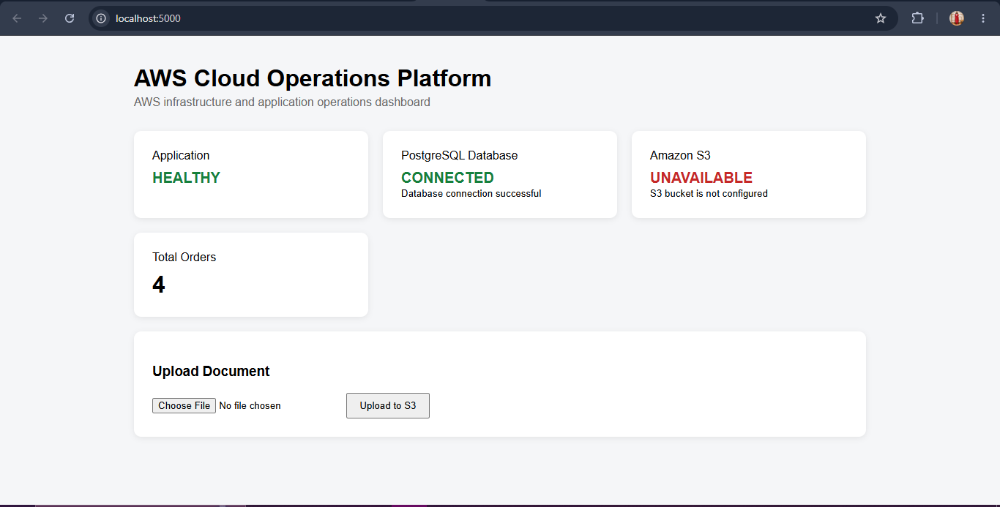
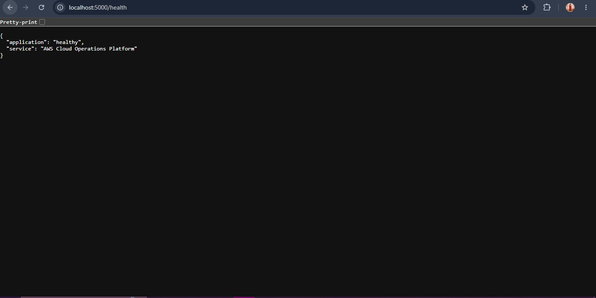
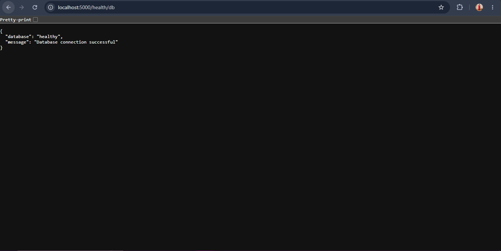
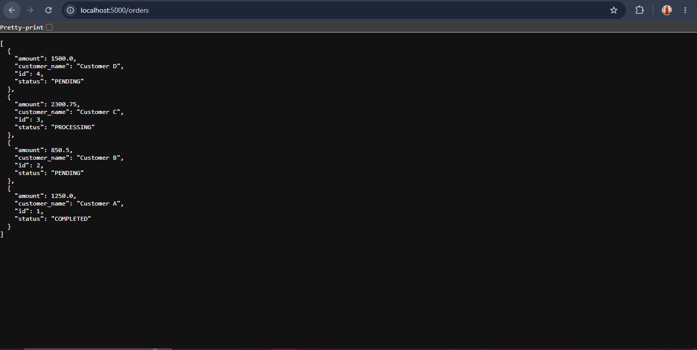

# Application Development

## What I Built

Before moving anything to AWS, I wanted to get a small application working locally. The idea was to build a realistic workload that I could later deploy on AWS and use to demonstrate cloud operations such as health checks, monitoring, troubleshooting, and failure recovery.

I kept the application simple rather than building a complex business product. I used Flask for the web application, PostgreSQL for storing order data, and Boto3 for integrating with AWS services.

The application provides a dashboard where I can check the application status, database connectivity, S3 status, and total number of orders. It also supports retrieving and creating orders through API endpoints and uploading files to Amazon S3.

## Technologies Used

- **Python and Flask** — application logic, dashboard, and API endpoints.
- **PostgreSQL** — storing and retrieving order data.
- **Boto3** — interacting with Amazon S3.
- **HTML** — building the application dashboard.
- **Environment variables** — managing application and database configuration.

## Application Structure

The application code is organized into the following files:

```text
app/
├── app.py
├── config.py
├── db.py
├── requirements.txt
└── templates/
    └── index.html
```

- `app.py` contains the Flask routes, dashboard logic, health checks, order APIs, and file upload functionality.
- `config.py` loads the application settings, database connection details, S3 bucket name, and AWS region from environment variables.
- `db.py` handles PostgreSQL connections, database health checks, and order counts.
- `requirements.txt` lists the Python packages needed to run the application.
- `templates/index.html` contains the HTML template used by the dashboard.

## Local Development and Testing

I developed and tested the application locally before moving on to the AWS deployment stage. This helped me verify the main application features and database integration before introducing the cloud environment.

### 1. Application Dashboard

The dashboard provides a single place to view the current state of the application and its dependencies. It displays the application status, PostgreSQL connection status, S3 status, and total number of orders. It also includes a file upload section.



### 2. Database Setup

For local development, I created a PostgreSQL database named `cloudops` and used an `orders` table to store customer order information.

The table contains the following fields:

| Column | Purpose |
|---|---|
| `id` | Identifies each order. |
| `customer_name` | Stores the customer's name. |
| `amount` | Stores the order amount. |
| `status` | Stores the current order status. |
| `created_at` | Records when the order was created. |

I inserted three initial orders so I had some data available for testing. I then created another order through the API, increasing the total from three to four. This confirmed that the application could write new records to PostgreSQL as well as retrieve existing ones.

### 3. Application Health Check

I added a separate health endpoint to check whether the Flask application was responding.

**Endpoint:** `GET /health`

The endpoint returns a JSON response indicating that the application is healthy. This provides a simple way to verify application availability without relying on the dashboard.



### 4. Database Health Check

I also added a dedicated database health endpoint.

**Endpoint:** `GET /health/db`

This endpoint attempts to connect to PostgreSQL and execute a basic query. A successful response confirms that the application can communicate with the database.



Separating the application health check from the database health check makes it easier to identify whether an issue is with the application itself or its database dependency.

### 5. Order Management

The application supports retrieving recent orders and creating new ones through its API.

- `GET /orders` retrieves recent orders from PostgreSQL.
- `POST /orders` accepts order details and inserts a new record into the database.

I tested order creation locally and verified that the new order was saved successfully. This helped confirm that the database integration supported both reading and writing data.



### 6. Amazon S3 Integration

I added the S3 integration needed for the AWS stage of the project. It includes a health check to test S3 connectivity and an endpoint to upload files to a configured bucket.

- `GET /health/s3` checks S3 connectivity.
- `POST /upload` accepts a file and uploads it to the configured S3 bucket.

During local development, the S3 bucket had not yet been configured in the local environment, so the dashboard showed S3 as unavailable. This was expected at that stage. The S3 integration code was in place, but the service still needed to be connected through the AWS environment.

## Configuration

I kept configuration separate from the application logic so that settings could be changed without modifying the Python files.

The application reads the following environment variables:

| Variable | Purpose |
|---|---|
| `APP_NAME` | Application name displayed by the dashboard. |
| `DB_HOST` | PostgreSQL server address. |
| `DB_PORT` | PostgreSQL port. |
| `DB_NAME` | Database name. |
| `DB_USER` | Database username. |
| `DB_PASSWORD` | Database password. |
| `S3_BUCKET` | Amazon S3 bucket name. |
| `AWS_REGION` | AWS region used for S3 integration. |

For local development, I used a `.env` file to provide the configuration values. The `.env` file contains environment-specific settings and should not be committed to the repository, particularly if it contains credentials.

## Running the Application Locally

The application can be started locally after Python, PostgreSQL, and the required configuration have been set up.

Install the dependencies:

```bash
pip install -r requirements.txt
```

Start the Flask application from the application directory:

```bash
python app.py
```

The application listens on port `5000` and can be accessed at:

```text
http://localhost:5000
```

The health endpoints can also be checked directly:

```text
http://localhost:5000/health
http://localhost:5000/health/db
http://localhost:5000/health/s3
```

These instructions are for local development. The Flask development server configuration is not intended for production use.

## Moving from Local Development to AWS

Once the application was working locally, the next stage was to deploy it to AWS and connect it to the required cloud resources.

This application serves as the workload for the broader AWS Cloud Operations Platform project. The focus of the overall project is not just the application itself, but also the deployment, monitoring, troubleshooting, and recovery of the environment in which it runs.

The AWS deployment and integration work is documented separately in the `app_deployment/` folder.

## Current Status

The local application development stage established the foundation for the AWS work. I verified that the Flask application started, the dashboard loaded, the health endpoints responded, PostgreSQL connectivity worked, and orders could be retrieved and created. The S3 integration code was also added, ready for configuration in the AWS environment.

The next stage was to use this application as a workload for the AWS Cloud Operations Platform and demonstrate how its infrastructure and dependencies could be operated and monitored.