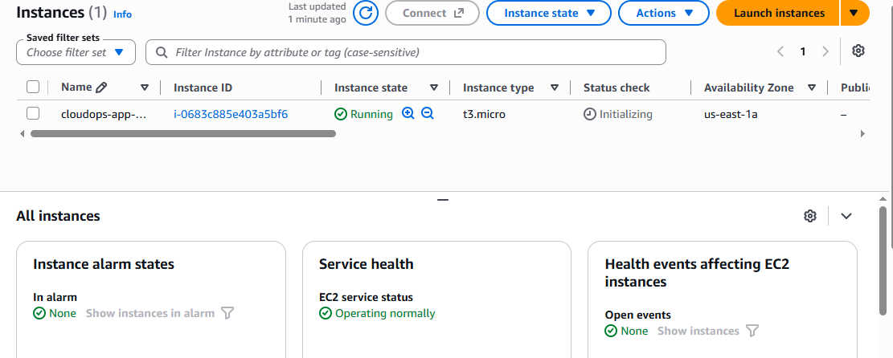

# EC2 Setup

After setting up the network, security groups, S3 access, and RDS, I created the EC2 instance that will host the application.

The instance is placed in the public subnet so that the application can be accessed externally during the project. Database access is still restricted through the RDS security group.

## Instance Configuration

- **Instance name:** `cloudops-ec2`
- **Region:** `us-east-1`
- **AMI:** Ubuntu Server 24.04 LTS
- **Instance type:** `t3.micro`
- **Subnet:** `cloudops-public-1`
- **Auto-assign public IP:** Enabled
- **Security group:** `cloudops-ec2-sg`
- **Root volume:** 8 GiB gp3
- **IAM role:** `cloudops-ec2-s3-role`

### EC2 Instance Evidence

## IAM Role

The EC2 instance uses the `cloudops-ec2-s3-role` instead of storing AWS access keys on the server.

This allows the application running on EC2 to access the S3 bucket through temporary IAM credentials.

The role is intentionally limited to the project S3 bucket.

## Network Placement

The EC2 instance is deployed in `cloudops-public-1` (`10.0.1.0/24`).

The public subnet has a route to the Internet Gateway, allowing external access to the application.

The RDS database remains in the private subnets and is not publicly accessible.

## Security

The EC2 security group allows:

- HTTP (80) from the internet
- SSH (22) only from my current IP

No unnecessary inbound ports were opened.

## Current Status

The EC2 instance is running and ready for application deployment.

The AWS infrastructure foundation is now complete. The next phase is to deploy the Python application and connect it to RDS and S3.