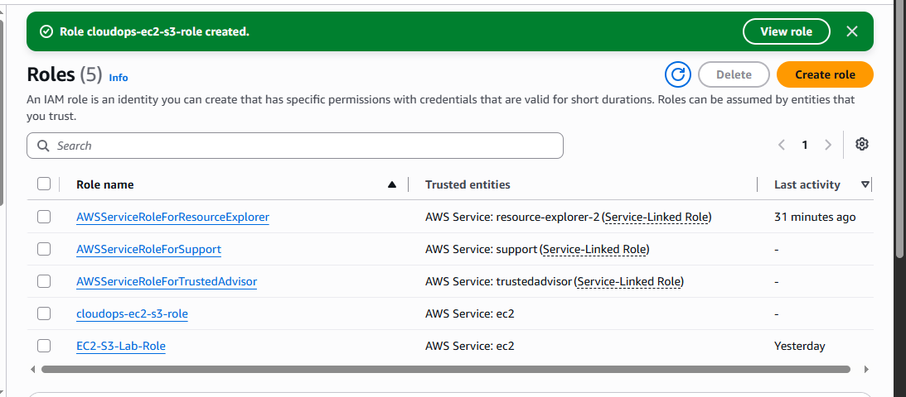
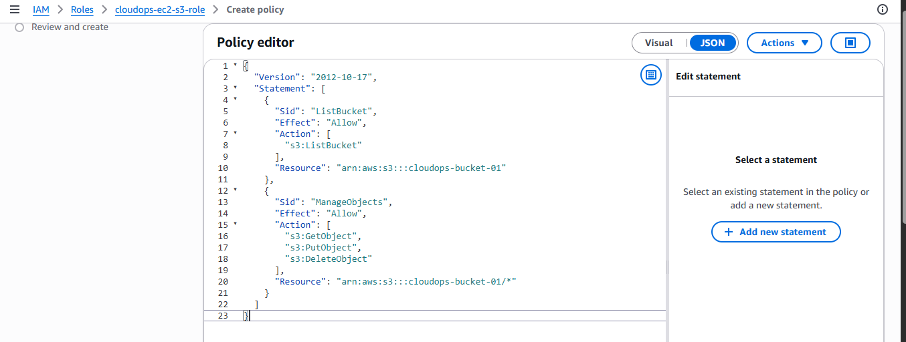

# IAM Role and S3 Access

After creating the S3 bucket, I needed a way for the EC2 instance to access it without storing AWS access keys on the server.

For this, I created an IAM role that can be attached directly to the EC2 instance. The role provides only the S3 permissions required by the application.

## IAM Role

The role is named:

```text
cloudops-ec2-s3-role
```



The role is trusted by the EC2 service, which allows an EC2 instance to assume the role and obtain temporary AWS credentials automatically.

This means the application running on EC2 does not need an AWS access key or secret access key stored in its configuration.

The access flow will be:

```text
EC2 Instance
     |
     v
IAM Role
cloudops-ec2-s3-role
     |
     v
S3 Permissions
cloudops-s3-access
     |
     v
cloudops-bucket-01
```

## S3 Access Policy

I created an inline policy named:

`cloudops-s3-access`

Instead of attaching a broad managed policy such as `AmazonS3FullAccess`, I created a custom policy with only the permissions required by the application.

The policy allows the EC2 application to:

- List the application bucket
- Read objects
- Upload objects
- Delete objects

It does not provide unrestricted access to other S3 buckets in the account.

### Policy JSON

```json
{
  "Version": "2012-10-17",
  "Statement": [
    {
      "Sid": "ListBucket",
      "Effect": "Allow",
      "Action": [
        "s3:ListBucket"
      ],
      "Resource": "arn:aws:s3:::cloudops-bucket-01"
    },
    {
      "Sid": "ManageObjects",
      "Effect": "Allow",
      "Action": [
        "s3:GetObject",
        "s3:PutObject",
        "s3:DeleteObject"
      ],
      "Resource": "arn:aws:s3:::cloudops-bucket-01/*"
    }
  ]
}
```



## Why the Policy Uses Two Different Resource ARNs

S3 has a distinction between the bucket itself and the objects stored inside the bucket.

The `ListBucket` permission applies to the bucket:

```text
arn:aws:s3:::cloudops-bucket-01
```

The object-level permissions apply to objects inside the bucket:

```text
arn:aws:s3:::cloudops-bucket-01/*
```

This is why the policy uses two separate statements.

The application therefore has access only to the resources it actually needs.

## Why I Used an IAM Role Instead of Access Keys

I deliberately avoided creating an IAM user and storing long-term access keys on the EC2 server.

Using an IAM role gives the EC2 instance temporary credentials through the AWS instance metadata service. The AWS SDK used by the Python application can automatically retrieve these credentials.

This is a better approach for an application running on AWS because:

- No AWS access keys need to be stored on the server.
- Credentials are temporary rather than long-lived.
- Permissions are attached to the workload through the EC2 role.
- Access can be controlled centrally through IAM.
- The policy follows the principle of least privilege.

## S3 Access from the Application

The Python application uses `boto3` to communicate with S3.

The application will use the EC2 IAM role when it runs on AWS, so there is no need to put AWS credentials in the application's `.env` file.

The application will use the bucket configured through:

```text
S3_BUCKET=cloudops-bucket-01
AWS_REGION=us-east-1
```

The S3 integration supports the application's file upload functionality.

The application also performs an S3 health check by verifying that the configured bucket is accessible.

## Security Considerations

The S3 bucket itself remains private.

Public access is blocked at the bucket level, and the application accesses the bucket through IAM permissions.

The IAM policy is also restricted to the specific bucket rather than granting access to all S3 resources.

This gives the application the access it needs while reducing the impact of an accidental or compromised application process.

## Current Status

At this stage, the following IAM and S3 components are configured:

- **IAM role:** `cloudops-ec2-s3-role`
- **Inline policy:** `cloudops-s3-access`
- **S3 bucket:** `cloudops-bucket-01`
- **Bucket access:** Private
- **Public S3 access:** Blocked
- **EC2 access method:** IAM role
- **S3 permissions:** Least privilege
- **AWS region:** `us-east-1`

The IAM role will be attached to the EC2 instance when the application infrastructure is deployed.
