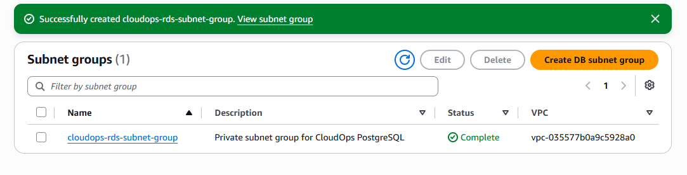
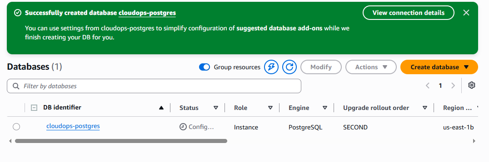

# RDS PostgreSQL Setup

After setting up the VPC, private subnets, and database security group, I created the PostgreSQL database that will be used by the CloudOps application.

The database is intentionally deployed in the private part of the VPC. It is not directly accessible from the Internet. The application running on EC2 will communicate with it over the internal VPC network.

## Database Configuration

The RDS instance is configured with:

- **DB identifier:** `cloudops-postgres`
- **Engine:** PostgreSQL 16.4
- **Initial database:** `cloudops`
- **Master username:** `cloudopsadmin`
- **Instance class:** `db.t4g.micro`
- **Storage:** 20 GiB
- **Storage type:** General Purpose SSD
- **Deployment:** Single-AZ
- **Region:** `us-east-1`

I chose PostgreSQL 16.4 because the local development environment uses PostgreSQL 16.1. The minor version is different, but both use the same PostgreSQL 16 major version.

## Network Configuration

The database is attached to the VPC created specifically for this project.

```text
VPC:
cloudops-vpc
10.0.0.0/16
```

The RDS instance uses the DB subnet group:

```text
cloudops-rds-subnet-group
```

The subnet group contains the two private subnets:

```text
us-east-1a
cloudops-private-1
10.0.11.0/24

us-east-1b
cloudops-private-2
10.0.12.0/24
```

### DB Subnet Group Evidence



The database is configured with:

**Public access:** No

This means the RDS instance does not receive a public IP address and is not intended to be accessed directly from the Internet.

### Security Group

The database uses:

```text
cloudops-rds-sg
```

The security group allows PostgreSQL traffic on port `5432` only from the EC2 security group.

The intended traffic flow is:

```text
Internet
    |
    v
   EC2
    |
    | TCP 5432
    v
RDS PostgreSQL
```

The database therefore does not need to expose port `5432` to the public Internet.

## Authentication

The database uses standard PostgreSQL password authentication.

The master username is:

```text
cloudopsadmin
```

The database password is kept outside the project documentation and source code.

Credentials will be provided to the application securely when the EC2 environment is configured.

## Encryption

Storage encryption is enabled using the AWS-managed RDS KMS key:

```text
alias/aws/rds
```

This ensures that the RDS storage is encrypted at rest without introducing the additional complexity of managing a custom KMS key for this lab.

## Backup Configuration

Automated backups are enabled with a retention period of:

```text
1 day
```

This is sufficient for the lab while still allowing us to demonstrate the RDS backup and recovery capabilities later.

I also left backup replication to another AWS Region disabled because this is a development/lab environment and cross-region replication is unnecessary for the project.

## Monitoring

Database Insights is configured in Standard mode.

Detailed database and per-query metrics are enabled with the available 7-day free retention period.

Enhanced Monitoring is not enabled because the standard RDS and CloudWatch metrics are sufficient for this project.

PostgreSQL log export to CloudWatch is enabled. These logs will be useful later when demonstrating database monitoring and troubleshooting.

## Availability

The database uses a Single-AZ deployment.

I deliberately did not enable Multi-AZ because this project is focused on demonstrating cloud operations, troubleshooting, security, and recovery rather than building a production-grade highly available database cluster.

The DB subnet group still spans two Availability Zones, which provides the required network structure for RDS and leaves the design ready for a future Multi-AZ configuration if needed.

## Application Connectivity

The Flask application will connect to RDS using the database endpoint provided by AWS.

The application will use:

```dotenv
DB_HOST=<RDS endpoint>
DB_PORT=5432
DB_NAME=cloudops
DB_USER=cloudopsadmin
DB_PASSWORD=<stored securely>
```

The important difference from the local setup is that the application will no longer connect to `localhost`.

Instead, the EC2 instance will connect to the private RDS endpoint through the VPC.

### RDS Instance Evidence



## Current Status

The database layer is now complete.

The current architecture is:

```text
          INTERNET
              |
              v
             EC2
              |
       -------------------
       |                 |
       v                 v
 RDS PostgreSQL          S3
 Private subnet     Private bucket
```

The next step is to create the EC2 instance that will host the Flask application.