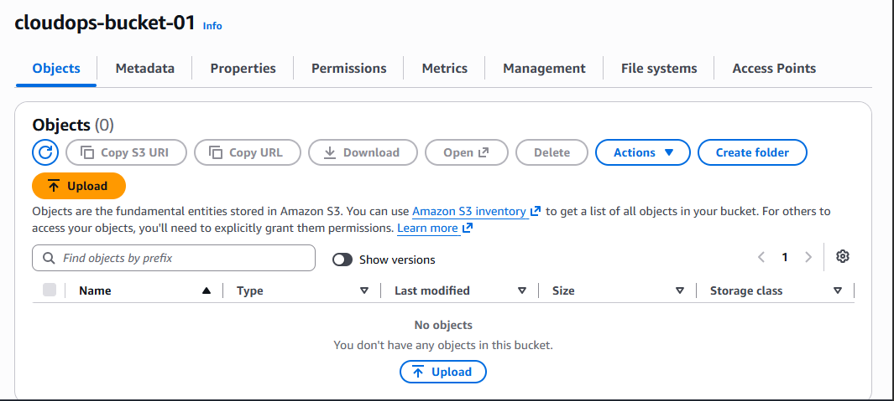

# S3 Setup

After setting up the basic network structure, I created an S3 bucket for the document storage part of the application.

The application will eventually use this bucket to upload and retrieve documents, so I wanted to keep the bucket private and enable recovery options from the beginning.

## Bucket Configuration

I created the bucket:

```text
cloudops-bucket-01
```

The bucket was created in the same AWS region as the rest of the project:

```text
us-east-1
```



I kept ACLs disabled and used Bucket owner enforced object ownership. This keeps object ownership simple and avoids relying on legacy ACL-based permissions.

## Public Access

All four Block Public Access settings are enabled.

The bucket is therefore not intended to serve files directly to the public internet. Access will instead be controlled through IAM permissions for the application.

This is important because the application only needs controlled access to the bucket; there is no reason for the stored documents to be publicly accessible.

## Versioning

I enabled S3 Versioning when creating the bucket.

This allows previous versions of objects to be retained if a document is accidentally overwritten or deleted. I will use this later as part of the recovery demonstration.

## Encryption

The bucket uses SSE-S3 for default server-side encryption.

This provides encryption for objects stored in the bucket without adding unnecessary complexity for this project.

## S3 Setup

At this point, the bucket is ready to be used by the application.

The bucket itself does not have public access. The application will receive the required permissions through an IAM role rather than storing AWS credentials inside the application.

## Current Status

The S3 storage layer is now ready.

The next step is to connect the EC2 application to the bucket securely using an IAM role with only the permissions required by the application.