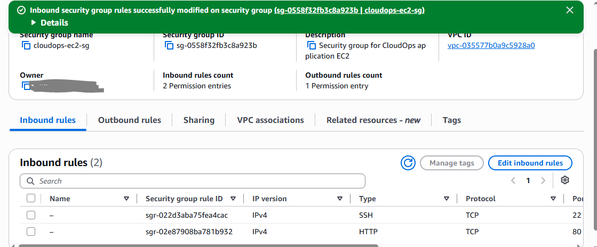
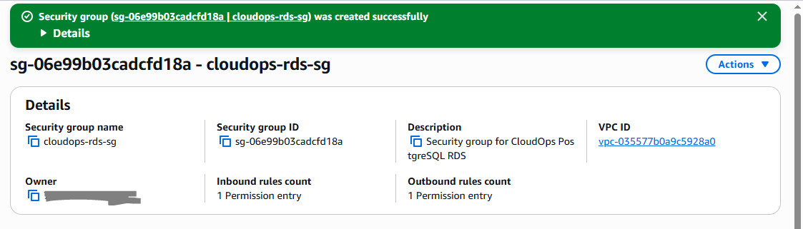

# Security Groups

Once the VPC and subnet structure was in place, I configured the Security Groups for the application and database layers.

The main goal here was to keep the application reachable from the internet while making sure the PostgreSQL database was not directly exposed.

## EC2 Security Group

I created a Security Group named `cloudops-ec2-sg` for the EC2 instance that will host the application.

For the initial setup, I allowed HTTP traffic on port 80 from the internet so that the application can be accessed through the web.

I also added SSH access on port 22, but restricted the source to my current IP address instead of opening SSH to the entire internet.

The resulting inbound rules are:

```text
HTTP : 80  →  0.0.0.0/0
SSH  : 22  →  My IP
```

This gives the application public web access while keeping administrative SSH access restricted.

### Evidence: EC2 Security Group Rules



## RDS Security Group

I then created a separate Security Group named `cloudops-rds-sg` for the PostgreSQL database.

The important part of this configuration is that I did not allow PostgreSQL traffic from the internet.

Instead, port `5432` is allowed only from the `cloudops-ec2-sg` Security Group.

The intended connection path is:

```text
EC2
cloudops-ec2-sg
      |
      | PostgreSQL : 5432
      v
RDS
cloudops-rds-sg
```

This means that the database accepts connections from the application server while remaining inaccessible directly from the public internet.

### Evidence: RDS Security Group Rules



## Result

At this point, the network-level access rules for the application and database layers are defined.

The intended traffic flow is:

```text
Internet
    |
    | HTTP : 80
    v
   EC2
    |
    | PostgreSQL : 5432
    v
   RDS
```

The Security Groups provide the first layer of network isolation. The database will later be placed in the private subnets, while the EC2 application will use the public subnets.