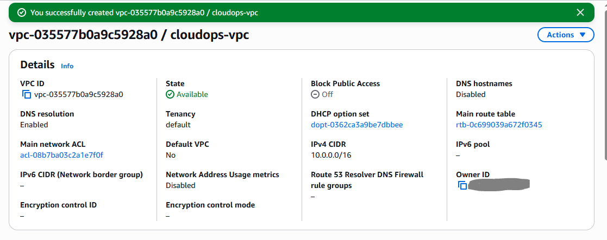
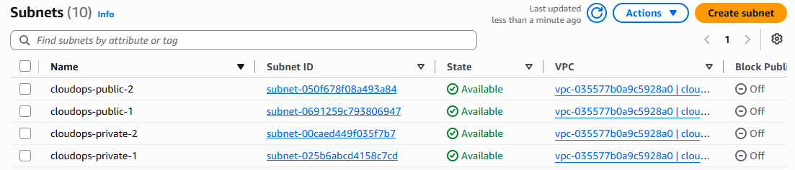
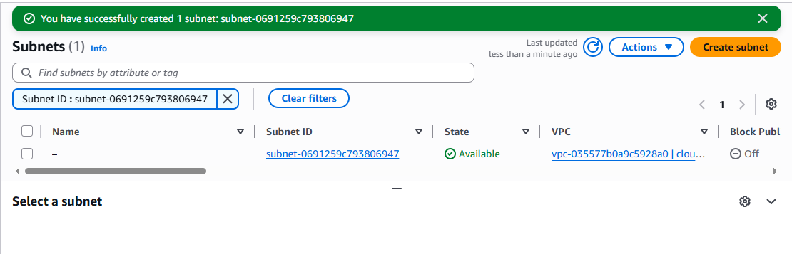
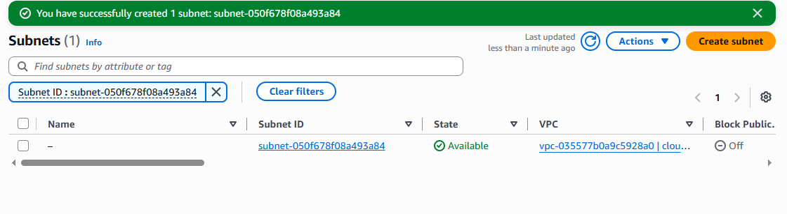
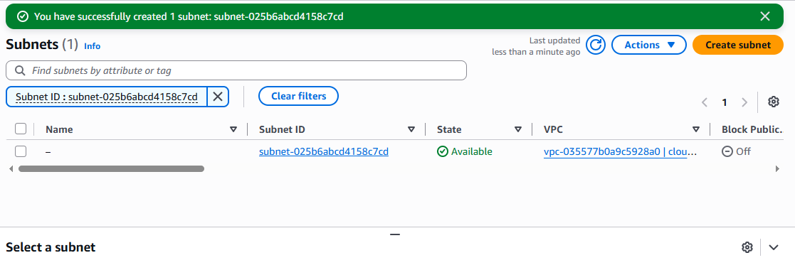
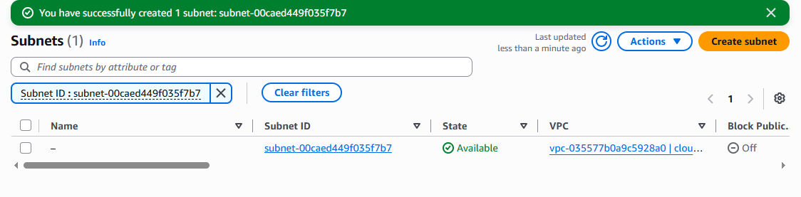
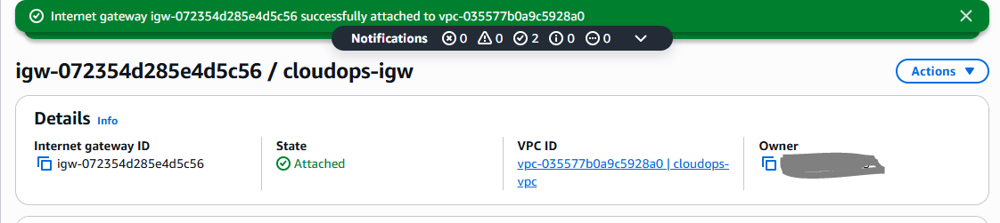
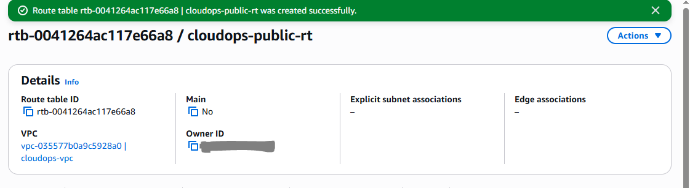
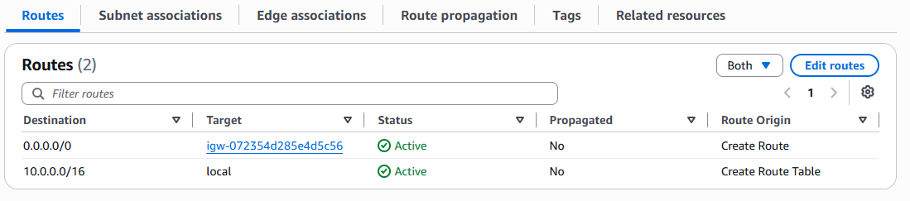

# VPC and Network Foundation

I started the AWS deployment by creating a dedicated VPC for the CloudOps platform.

The VPC uses the `10.0.0.0/16` CIDR range. I chose a `/16` network so that the VPC has enough address space to be divided into multiple smaller subnets as the infrastructure grows.

## VPC

- **Name:** `cloudops-vpc`
- **CIDR:** `10.0.0.0/16`
- **Region:** `us-east-1`
- **IPv6:** Not enabled

### VPC Creation



## Subnet Layout

I divided the VPC across two Availability Zones and separated the application and database tiers.

| Subnet | Availability Zone | CIDR | Purpose |
|---|---|---|---|
| `cloudops-public-1` | `us-east-1a` | `10.0.1.0/24` | EC2 application workload |
| `cloudops-public-2` | `us-east-1b` | `10.0.2.0/24` | Secondary application/ALB workload |
| `cloudops-private-1` | `us-east-1a` | `10.0.11.0/24` | RDS database |
| `cloudops-private-2` | `us-east-1b` | `10.0.12.0/24` | RDS database |

### Subnet Creation Evidence

**Initial subnet creation**



**Public subnet 1**



**Public subnet 2**



**Private subnet 1**



**Private subnet 2**



## Internet Connectivity

An Internet Gateway named `cloudops-igw` was created and attached to the VPC.



A dedicated route table named `cloudops-public-rt` was created for the public subnets.



The route table contains:

```text
10.0.0.0/16 → local
0.0.0.0/0   → cloudops-igw
```

