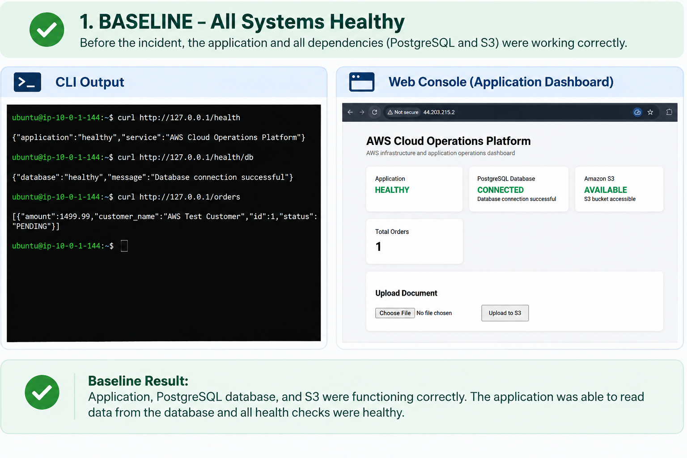
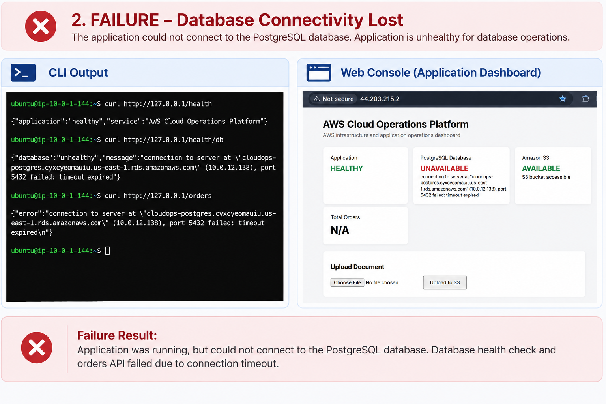
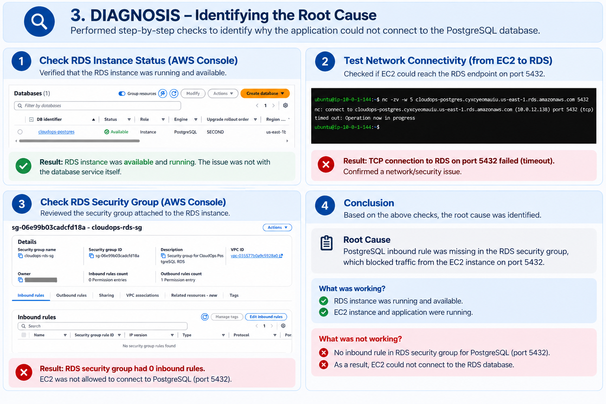
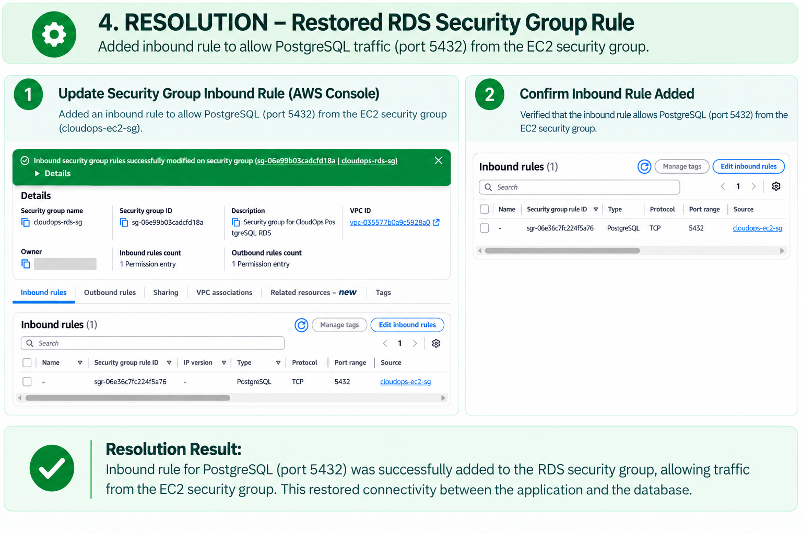
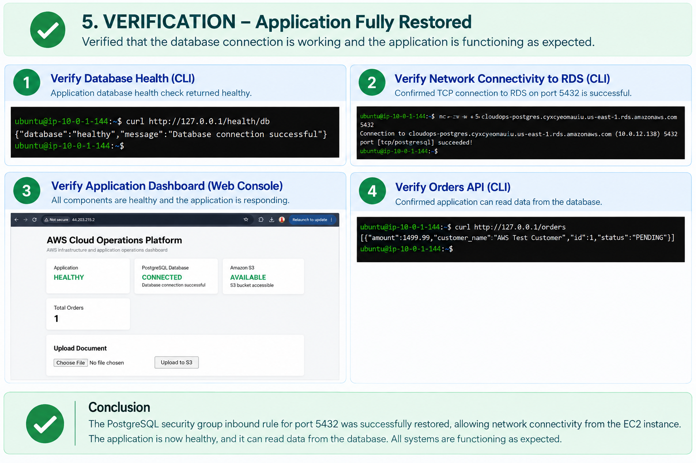

# Incident 01 — Database Connectivity Failure

## Incident Objective

I intentionally introduced a database connectivity failure by removing the inbound PostgreSQL rule from the RDS security group.

The purpose was to demonstrate a realistic AWS troubleshooting workflow rather than simply showing a successful deployment. The incident tests whether I can distinguish an application problem from an infrastructure/networking problem, identify the affected layer, determine the root cause, restore the intended configuration, and verify recovery end to end.

The failure was introduced in a controlled environment and was fully restored after the diagnosis.

## Baseline

Before introducing the failure, I verified that the application and its dependencies were healthy.

From the EC2 instance, I ran the following commands:

```bash
curl http://127.0.0.1/health
curl http://127.0.0.1/health/db
curl http://127.0.0.1/orders
```

The application health check returned healthy, the database health check confirmed a successful PostgreSQL connection, and the orders API returned the expected order from RDS.

The application dashboard also showed:

| Component | Status |
|---|---|
| Application | HEALTHY |
| PostgreSQL Database | CONNECTED |
| Amazon S3 | AVAILABLE |
| Total Orders | 1 |

This established the known-good state before the incident.

### Baseline Evidence — All Systems Healthy

)

## Failure Introduction

The failure was introduced by removing the inbound PostgreSQL rule from the RDS security group:

`cloudops-rds-sg`

The original rule allowed:

| Setting | Value |
|---|---|
| Type | PostgreSQL |
| Protocol | TCP |
| Port | 5432 |
| Source | `cloudops-ec2-sg` |

I removed this rule intentionally.

The expected impact was that the EC2 application would no longer be able to establish a TCP connection to the private RDS instance on port 5432.

No application code or database credentials were changed.

## Detecting the Failure

I first checked the application and database health endpoints from the EC2 instance:

```bash
curl http://127.0.0.1/health
curl http://127.0.0.1/health/db
curl http://127.0.0.1/orders
```

The application itself remained healthy:

```json
{
  "application": "healthy",
  "service": "AWS Cloud Operations Platform"
}
```

However, the database health check failed with a TCP timeout:

```text
{
  "database": "unhealthy",
  "message": "connection to server at \"cloudops-postgres.cyxcyeomauiu.us-east-1.rds.amazonaws.com\" (10.0.12.138), port 5432 failed: timeout expired\n"
}
```

The orders API also failed because it depends on the database:

```text
{
  "error": "connection to server at \"cloudops-postgres.cyxcyeomauiu.us-east-1.rds.amazonaws.com\" (10.0.12.138), port 5432 failed: timeout expired\n"
}
```

This immediately showed an important distinction: the EC2 application process and web layer were still working, while the database dependency was unavailable.

### Failure Evidence



## Diagnosis

I approached the problem from the application layer down toward the infrastructure layer instead of changing multiple things at once.

### Step 1 — Check RDS Instance Status

I checked the RDS instance `cloudops-postgres` in the AWS Console.

Its status was:

```text
Available
```

This ruled out an RDS instance failure as the immediate cause.

### Step 2 — Test TCP Connectivity to PostgreSQL

Because the application error showed a connection timeout on port 5432, I tested the network path directly from EC2:

```bash
nc -zv -w 5 cloudops-postgres.cyxcyeomauiu.us-east-1.rds.amazonaws.com 5432
```

The result was:

```text
nc: connect to cloudops-postgres.cyxcyeomauiu.us-east-1.rds.amazonaws.com (10.0.12.138) port 5432 (tcp) timed out: Operation now in progress
```

This confirmed that the failure was below the application layer: EC2 could resolve the RDS hostname, but a TCP connection to PostgreSQL port 5432 could not be established.

I did not treat this as an authentication problem because the connection was timing out before a PostgreSQL session could be established.

### Step 3 — Inspect the RDS Security Group

I checked the inbound rules of:

`cloudops-rds-sg`

The security group had:

```text
Inbound rules count: 0
```

There was no PostgreSQL/TCP 5432 rule allowing traffic from `cloudops-ec2-sg`.

This matched the TCP timeout and identified the missing inbound rule as the cause of the connectivity failure.

## Root Cause

The root cause was an incorrect RDS security-group configuration.

The inbound rule permitting PostgreSQL traffic on TCP port 5432 from the EC2 security group had been removed.

The resulting network path was:

```text
EC2 application
      |
      v
VPC networking
      |
      v
RDS security group
      |
      X  TCP 5432 blocked
      |
      v
RDS PostgreSQL
```

The application itself was healthy, and the RDS instance was available. The failure was caused by the security-group rule preventing the EC2-to-RDS connection.

### Diagnosis Evidence



## Resolution

I restored the intended inbound rule on `cloudops-rds-sg`:

| Setting | Value |
|---|---|
| Type | PostgreSQL |
| Protocol | TCP |
| Port | 5432 |
| Source | `cloudops-ec2-sg` |

I deliberately used the EC2 security group as the source instead of allowing a broad CIDR such as `0.0.0.0/0`.

This preserves the intended least-privilege network design: the RDS security group permits inbound PostgreSQL traffic from resources associated with `cloudops-ec2-sg`, rather than exposing port 5432 broadly.

### Resolution Evidence



## Verification

### 1. Verify TCP Connectivity

After restoring the rule, I repeated the same TCP test:

```bash
nc -zv -w 5 cloudops-postgres.cyxcyeomauiu.us-east-1.rds.amazonaws.com 5432
```

The connection succeeded:

```text
Connection to cloudops-postgres.cyxcyeomauiu.us-east-1.rds.amazonaws.com (10.0.12.138) 5432 port [tcp/postgresql] succeeded!
```

### 2. Verify Application Database Health

I then tested the application-level database health endpoint:

```bash
curl http://127.0.0.1/health/db
```

The result was:

```json
{
  "database": "healthy",
  "message": "Database connection successful"
}
```

This confirmed that the application could establish a PostgreSQL connection again.

The application dashboard also returned to the expected healthy state:

| Component | Status |
|---|---|
| Application | HEALTHY |
| PostgreSQL Database | CONNECTED |
| Amazon S3 | AVAILABLE |
| Total Orders | 1 |

### 3. Verify Application Functionality

Finally, I tested the orders API:

```bash
curl http://127.0.0.1/orders
```

The application successfully retrieved the order from the RDS-backed database:

```json
[
  {
    "amount": 1499.99,
    "customer_name": "AWS Test Customer",
    "id": 1,
    "status": "PENDING"
  }
]
```

This provided the final end-to-end verification: the EC2-hosted application could once again reach RDS and read application data.

### Verification Evidence



## Troubleshooting Summary

| Check | Result | Conclusion |
|---|---|---|
| Application `/health` | Healthy | Application/web layer was working |
| RDS status | Available | RDS instance was running |
| Application DB health | Timeout | Database dependency unavailable |
| TCP 5432 before fix | Timeout | Network/security path failure |
| RDS security-group inbound rules | 0 | PostgreSQL traffic was not permitted |
| PostgreSQL rule after fix | Restored | Intended access restored |
| TCP 5432 after fix | Succeeded | Network connectivity recovered |
| DB health after fix | Healthy | Application reconnected to RDS |

## Lessons Learned

This incident reinforced several operational troubleshooting principles.

### 1. Application Health Does Not Guarantee Dependency Health

The application continued to respond to `/health` even while its database dependency was unavailable. A service can therefore appear healthy at the process/web layer while being functionally degraded.

### 2. Test the Failing Layer Directly

The TCP test with `nc` was useful because it removed the application code from the equation. Once port 5432 timed out, the investigation could focus on the network/security path.

### 3. A Timeout Is Different from an Authentication Failure

The connection never reached a successful PostgreSQL session. The timeout pointed toward connectivity/security controls rather than incorrect database credentials.

### 4. Security Groups Should Be Specific

The intended configuration allows inbound PostgreSQL traffic from `cloudops-ec2-sg`. This is preferable to exposing port 5432 broadly.

### 5. Change One Thing at a Time During Troubleshooting

The incident was deliberately isolated to one infrastructure change. This made the diagnosis clearer and allowed the same tests to be repeated before and after the fix.
