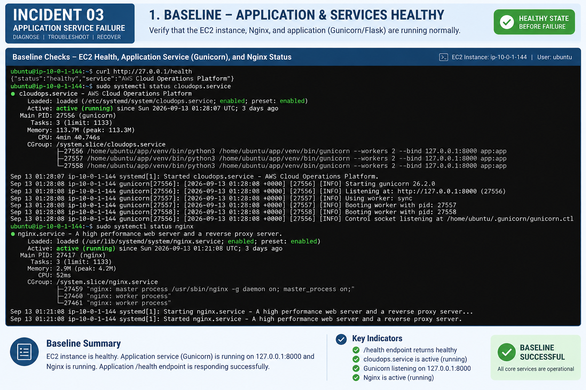
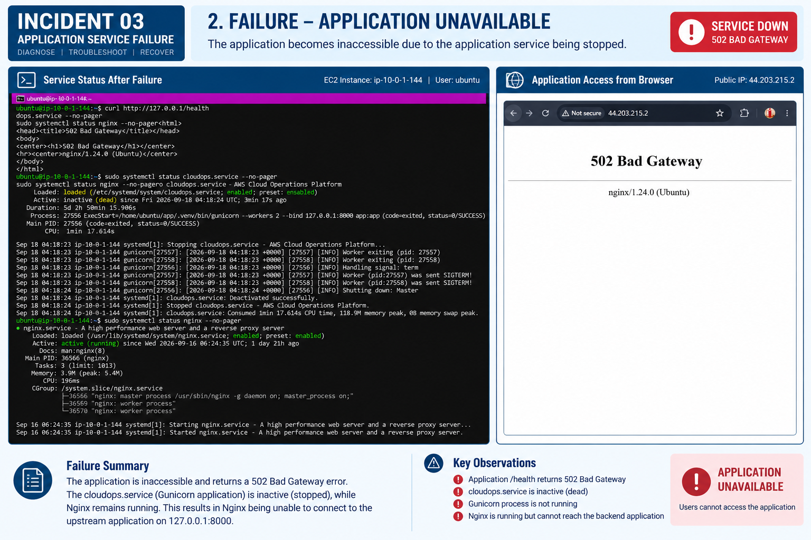
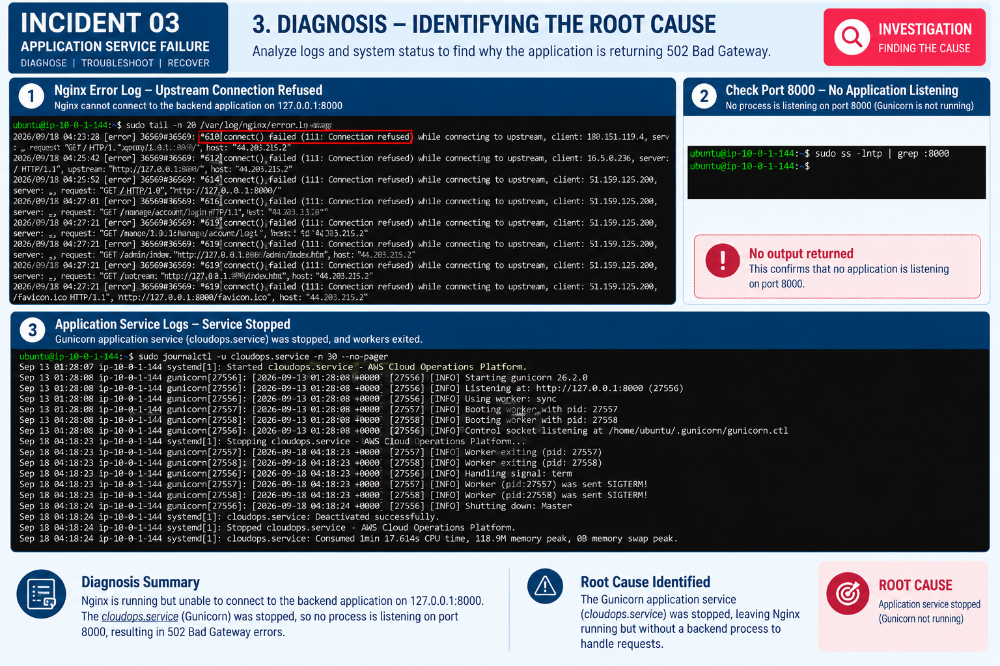
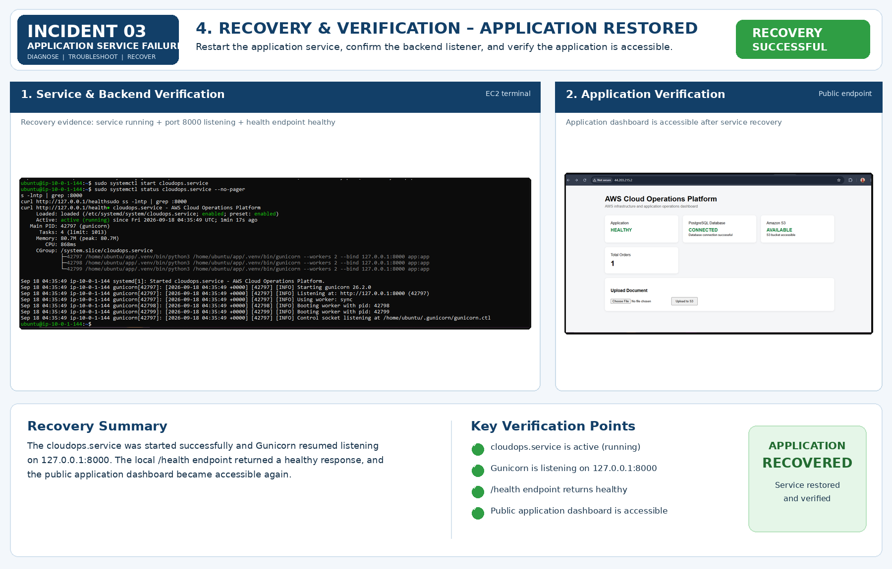

# Incident 03 — Application Service Failure

## Incident Objective

In this incident, I simulated an application-level failure on the EC2 instance by stopping the `cloudops.service` systemd service that runs the Flask application through Gunicorn.

The purpose was to demonstrate an important operational distinction:

**EC2 health does not necessarily mean application health.**

The EC2 instance remained available, Nginx remained running, and the application infrastructure itself was intact. However, because the Gunicorn backend was stopped, Nginx could not reach the application on `127.0.0.1:8000` and returned a `502 Bad Gateway` response.

This incident was investigated using the application endpoint, Linux service status, Nginx error logs, socket/listener checks, and systemd journal logs. The application was then recovered by starting the application service and verifying the complete request path.

## Expected Architecture Path

```text
User / Browser
      |
      v
    Nginx
      |
      v
Gunicorn / Flask
127.0.0.1:8000
      |
      +----> PostgreSQL RDS
      |
      +----> Amazon S3
```

## Baseline

Before introducing the failure, I verified that the application and supporting services were operating normally.

### Checks Performed

```bash
curl http://127.0.0.1/health
sudo systemctl status cloudops.service --no-pager
sudo systemctl status nginx --no-pager
```

The `/health` endpoint returned a healthy response.

The `cloudops.service` systemd service was active and running, with Gunicorn listening on:

`127.0.0.1:8000`

Nginx was also active and running.

### Baseline Result

The application, Gunicorn backend, and Nginx web server were healthy before the controlled failure.

### Baseline Evidence



## Failure Introduction

The following command was used to intentionally stop the application service:

```bash
sudo systemctl stop cloudops.service
```

No changes were made to the EC2 instance, Nginx configuration, RDS connectivity, S3 permissions, or security groups.

## Detecting the Failure

After the service was stopped, accessing the application resulted in:

```text
502 Bad Gateway
```

The service status showed:

```text
cloudops.service
Active: inactive (dead)
```

At the same time, Nginx remained:

```text
Active: active (running)
```

This was important because it showed that the web server itself was still operational. The failure was occurring behind Nginx, at the application service layer.

### Failure Result

The application became unavailable while Nginx continued to run.

### Failure Evidence



## Diagnosis

I approached the problem from the request path rather than immediately restarting the service.

### Step 1 — Check Nginx Error Log

I checked the latest Nginx error entries:

```bash
sudo tail -n 20 /var/log/nginx/error.log
```

The log showed:

```text
connect() failed (111: Connection refused) while connecting to upstream
upstream: "http://127.0.0.1:8000/"
```

This established that Nginx was attempting to forward requests to the Gunicorn backend on port 8000, but the connection was being refused.

The unrelated requests for paths such as `/login`, `/admin`, `/cgi-bin/`, and others were external requests visible in the server log and were not part of the controlled incident.

### Step 2 — Check Whether Port 8000 Was Listening

To independently verify the backend listener, I ran:

```bash
sudo ss -lntp | grep :8000
```

No output was returned.

This confirmed that there was no process listening on TCP port 8000, which is where Gunicorn normally serves the Flask application.

### Step 3 — Check the Application Service Journal

I then checked the systemd journal for the application service:

```bash
sudo journalctl -u cloudops.service -n 30 --no-pager
```

The logs showed that Gunicorn had previously started and was listening on `127.0.0.1:8000`.

They then showed the service being stopped:

```text
Stopping cloudops.service
Worker exiting
Handling signal: term
Shutting down: Master
cloudops.service: Deactivated successfully.
Stopped cloudops.service
```

This confirmed that the Gunicorn application service had been stopped and its worker processes had exited.

### Diagnosis Evidence



## Root Cause

The root cause was a stopped Gunicorn application service (`cloudops.service`), leaving Nginx running without a backend application process listening on `127.0.0.1:8000`.

The failure chain was:

```text
cloudops.service stopped
        |
        v
Gunicorn workers exited
        |
        v
Nothing listening on 127.0.0.1:8000
        |
        v
Nginx cannot connect to upstream
        |
        v
502 Bad Gateway
        |
        v
Application unavailable
```

This also demonstrates why checking only the EC2 instance or Nginx status is not sufficient to determine application availability.

## Resolution

After the root cause was confirmed, I restored the application service:

```bash
sudo systemctl start cloudops.service
```

The command completed without output, indicating that the service start command was accepted.

## Verification

### Step 1 — Verify Application Service and Backend Listener

I checked the application service status and backend listener:

```bash
sudo systemctl status cloudops.service --no-pager
sudo ss -lntp | grep :8000
```

The results confirmed that:

- `cloudops.service` was active (running).
- Gunicorn was listening on `127.0.0.1:8000`.

### Step 2 — Verify Application Health

I tested the application health endpoint:

```bash
curl http://127.0.0.1/health
```

The endpoint returned a healthy application response.

### Step 3 — Verify Public Application Access

I then verified the application through the public EC2 endpoint and confirmed that the application dashboard was accessible again.

### Verification Result

The application was fully restored and accessible after restarting the application service.

### Verification Evidence



## Troubleshooting Summary

| Check | Result | Conclusion |
|---|---|---|
| EC2 instance | Available | Instance remained operational |
| Application `/health` before failure | Healthy | Application was initially responding |
| `cloudops.service` after failure | Inactive (dead) | Gunicorn application service was stopped |
| Nginx status after failure | Active (running) | Web server remained operational |
| Nginx error log | Connection refused | Nginx could not reach the backend |
| TCP port 8000 listener | No output | No process was listening on the backend port |
| systemd journal | Service stopped | Application service shutdown was confirmed |
| `cloudops.service` after recovery | Active (running) | Application service was restored |
| TCP port 8000 after recovery | Listening | Gunicorn backend listener was restored |
| Application `/health` after recovery | Healthy | Application health was restored |
| Public application dashboard | Accessible | End-to-end application access recovered |

## Lessons Learned

This incident reinforced several practical troubleshooting principles.

### 1. Separate Infrastructure Health from Application Health

An EC2 instance can be running while the application hosted on it is unavailable.

### 2. Follow the Request Path

Starting with the 502 response and then checking Nginx, the upstream port, and the application service narrowed the failure to the application layer.

### 3. Use Multiple Sources of Evidence

Nginx logs, socket/listener information, and systemd logs independently supported the same diagnosis.

### 4. Do Not Restart Blindly

The service was restarted only after confirming that the backend process was not running and identifying the service state.

### 5. Verify Recovery at Multiple Levels

Service status alone was not considered sufficient. The backend listener, health endpoint, and public application were all checked.

## Final Incident Outcome

**Status: Recovered**

The controlled application failure was diagnosed as a stopped Gunicorn service. Nginx remained healthy but could not reach its configured upstream at `127.0.0.1:8000`, resulting in `502 Bad Gateway` responses.

Restarting `cloudops.service` restored Gunicorn, restored the listener on port 8000, returned the health endpoint to a healthy state, and restored public application access.

This completes the third controlled incident in the AWS Cloud Operations & Infrastructure Troubleshooting project.
