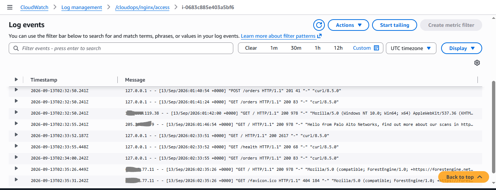
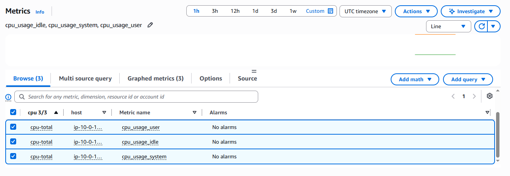
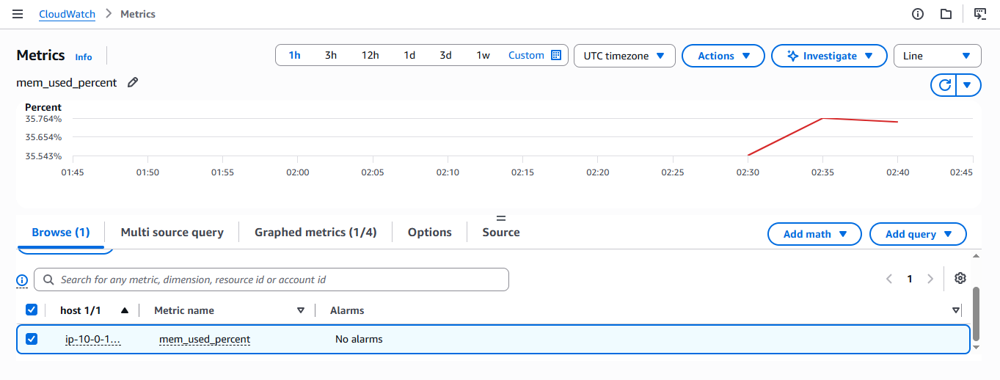
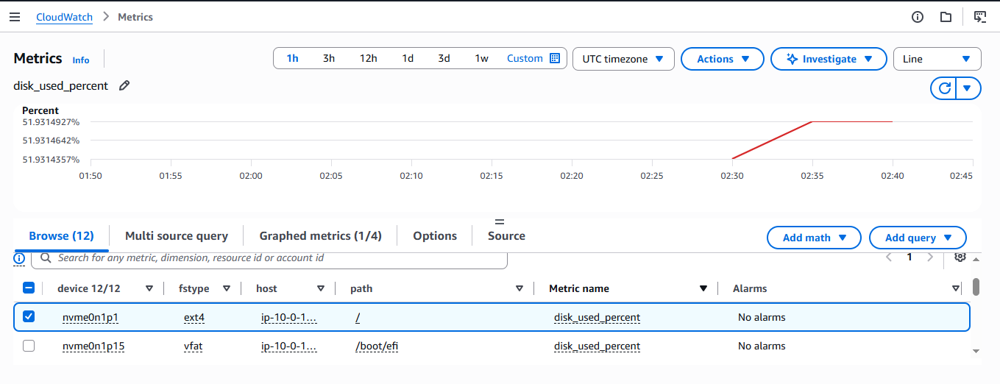
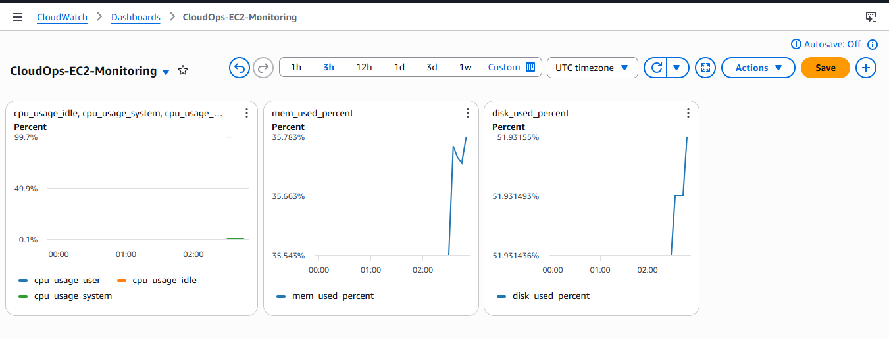
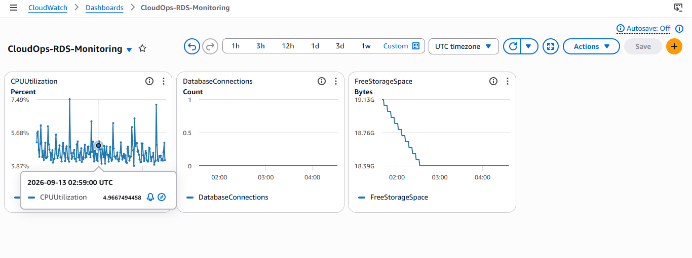

# CloudWatch Monitoring

## Why I Added Monitoring

Once the application was running on EC2 and connected to RDS and S3, I wanted visibility into the environment instead of relying only on manual checks.

The goal was to monitor the basic health of the EC2 host, keep visibility into the database, collect application-facing logs that could help during troubleshooting, and configure alarms that could notify me when important operational thresholds were crossed.

I kept the monitoring setup focused on signals that would be useful for the incidents planned for this project.

## 1. CloudWatch Agent on EC2

The EC2 instance did not have the CloudWatch Agent installed by default, so I installed the Amazon CloudWatch Agent on the Ubuntu server.

The agent was configured to collect:

- EC2 CPU metrics
- Memory utilization
- Root filesystem disk utilization
- Nginx access logs
- Nginx error logs

The custom metrics are published under the namespace:

```text
CloudOps/EC2
```

I started the agent and enabled it as a system service, then verified that it was running before checking CloudWatch.

## 2. IAM Permissions for Monitoring

The EC2 instance uses the IAM role:

```text
cloudops-ec2-s3-role
```

Initially, this role only had the S3 permissions required by the application. When the CloudWatch Agent started, it could run locally, but CloudWatch rejected metric and log publishing requests because the role did not yet have the required CloudWatch permissions.

I treated this as an IAM permission issue rather than broadening the existing S3 policy.

I added a separate inline policy:

```text
cloudops-cloudwatch-agent
```

The policy allows the agent to:

- Publish CloudWatch metrics
- Create the required `/cloudops/*` log groups and streams
- Describe log streams
- Publish log events

Keeping these permissions separate from the S3 policy maintains the least-privilege approach used elsewhere in the project.

## 3. Nginx Log Collection

I configured the CloudWatch Agent to collect these Nginx logs:

```text
/var/log/nginx/access.log
/var/log/nginx/error.log
```

They are sent to the following CloudWatch log groups:

```text
/cloudops/nginx/access
/cloudops/nginx/error
```

I generated application traffic and verified that the log groups appeared in CloudWatch. The access log stream contained real requests such as:

- `GET /`
- `GET /health`
- `GET /orders`
- `POST /upload`

This confirmed the logging path:

```text
EC2
  ↓
Nginx
  ↓
CloudWatch Agent
  ↓
CloudWatch Logs
```

### Evidence: Nginx Access Logs



## 4. EC2 Metrics

The CloudWatch Agent publishes EC2 custom metrics under:

```text
CloudOps/EC2
```

The metrics I configured are:

| Resource signal | Metric names |
|---|---|
| CPU | `cpu_usage_user`, `cpu_usage_idle`, `cpu_usage_system` |
| Memory | `mem_used_percent` |
| Disk | `disk_used_percent` |

The root filesystem being monitored is:

| Property | Value |
|---|---|
| Device | `nvme0n1p1` |
| Filesystem | `ext4` |
| Path | `/` |

The metrics appeared in CloudWatch with live data, confirming that the CloudWatch Agent was publishing them successfully.

### Evidence: CPU Metrics



### Evidence: Memory Utilization



### Evidence: Disk Utilization



## 5. EC2 Monitoring Dashboard

I created a dedicated CloudWatch dashboard named:

```text
CloudOps-EC2-Monitoring
```

It contains three focused widgets:

- CPU
- Memory
- Disk

I kept these as separate widgets so each operational signal can be viewed independently.

### Evidence: EC2 Monitoring Dashboard



## 6. RDS Monitoring

I created a separate dashboard for the PostgreSQL database:

```text
CloudOps-RDS-Monitoring
```

The dashboard contains the following metrics:

### CPU Utilization

Metric: `CPUUtilization`

This helps identify database-side compute pressure.

### Database Connections

Metric: `DatabaseConnections`

This helps identify changes in the number of active database connections and will be useful when investigating database connectivity problems.

### Free Storage

Metric: `FreeStorageSpace`

This provides visibility into the remaining database storage.

The RDS dashboard is separate from the EC2 dashboard because the database and application server have different operational concerns.

### Evidence: RDS Monitoring Dashboard



## 7. CloudWatch Alarms and Notifications

After validating the monitoring dashboards, I added alarms for the operational conditions most relevant to this project.

I used one SNS topic:

```text
cloudops-alerts
```

The topic has one confirmed email subscription. All five alarms publish to this same topic.

The notification flow is:

```text
CloudWatch Alarm
      ↓
SNS topic: cloudops-alerts
      ↓
Confirmed email subscription
```

### EC2 Alarms

#### High CPU

| Setting | Value |
|---|---|
| Alarm | `CloudOps-EC2-High-CPU` |
| Metric | `CPUUtilization` |
| Statistic | Average |
| Period | 5 minutes |
| Condition | Greater than 70% |
| Evaluation | 1 out of 1 datapoints |

#### High Memory

| Setting | Value |
|---|---|
| Alarm | `CloudOps-EC2-High-Memory` |
| Metric | `mem_used_percent` |
| Statistic | Average |
| Period | 5 minutes |
| Condition | Greater than 80% |
| Evaluation | 1 out of 1 datapoints |

This uses the memory metric published by the CloudWatch Agent because standard EC2 metrics do not provide operating-system memory utilization.

#### High Disk

| Setting | Value |
|---|---|
| Alarm | `CloudOps-EC2-High-Disk` |
| Metric | `disk_used_percent` |
| Statistic | Average |
| Period | 5 minutes |
| Condition | Greater than 80% |
| Evaluation | 1 out of 1 datapoints |

### RDS Alarms

#### High CPU

| Setting | Value |
|---|---|
| Alarm | `CloudOps-RDS-High-CPU` |
| Metric | `CPUUtilization` |
| Statistic | Average |
| Period | 5 minutes |
| Condition | Greater than 80% |
| Evaluation | 1 out of 1 datapoints |

#### Low Free Storage

| Setting | Value |
|---|---|
| Alarm | `CloudOps-RDS-Low-Free-Storage` |
| Metric | `FreeStorageSpace` |
| Statistic | Average |
| Period | 5 minutes |
| Condition | Less than or equal to 5 GiB |
| Evaluation | 1 out of 1 datapoints |

The RDS instance has 20 GiB of allocated storage, so I used 5 GiB of remaining free space as the alarm threshold.

### Alarm Status

All five planned alarms were created in CloudWatch:

- `CloudOps-EC2-High-CPU`
- `CloudOps-EC2-High-Memory`
- `CloudOps-EC2-High-Disk`
- `CloudOps-RDS-High-CPU`
- `CloudOps-RDS-Low-Free-Storage`

The four established alarms were in the `OK` state. The newly created RDS free-storage alarm initially showed `Insufficient data`, which is expected while CloudWatch collects enough datapoints for a new alarm.

### SNS Notification Verification

The SNS subscription was initially pending confirmation. After requesting confirmation again, I confirmed the subscription through the AWS email.

The final subscription status was `Confirmed`. This means the alarms can send notifications through the configured SNS topic.

## 8. Current Monitoring Design

The monitoring setup brings together EC2 metrics, RDS metrics, application-facing logs, alarms, and email notifications.

- **EC2:** CPU, memory, and disk metrics are collected by the CloudWatch Agent.
- **Nginx:** Access and error logs are sent to CloudWatch Logs.
- **RDS:** A separate dashboard tracks CPU utilization, database connections, and free storage.
- **CloudWatch Alarms:** Five alarms track the selected EC2 and RDS thresholds.
- **SNS:** The `cloudops-alerts` topic distributes alarm notifications to a confirmed email subscription.

The RDS PostgreSQL logs are also available in:

```text
/aws/rds/instance/cloudops-postgres/postgresql
```

## 9. Verification

I verified monitoring at multiple levels instead of assuming that a running agent meant monitoring was working.

### Agent Level

The `amazon-cloudwatch-agent.service` service was active and running.

### Logs Level

The following CloudWatch log groups appeared:

```text
/cloudops/nginx/access
/cloudops/nginx/error
```

Actual HTTP requests were visible in the access log stream.

### Metrics Level

The custom namespace `CloudOps/EC2` appeared and contained the configured CPU, memory, and disk metrics.

### Dashboard Level

Both monitoring dashboards were created and populated with metric data.

### Alarm Level

All five planned alarms were created and connected to the `cloudops-alerts` SNS topic. The SNS email subscription was confirmed successfully.

This gave me a verified monitoring and alerting baseline before moving into the controlled incident simulations.

## Current Status

CloudWatch monitoring and alerting for the core EC2 and RDS environment is in place.

The environment has:

- CloudWatch Agent metrics for EC2
- Nginx access and error log collection
- Dedicated EC2 and RDS dashboards
- Five operational CloudWatch alarms
- A shared SNS notification topic
- A confirmed email subscription

The next stage is to use this monitoring setup during the controlled incident scenarios. This will demonstrate not only how the infrastructure is monitored, but also how monitoring and alerts help identify, diagnose, and recover from operational failures.
